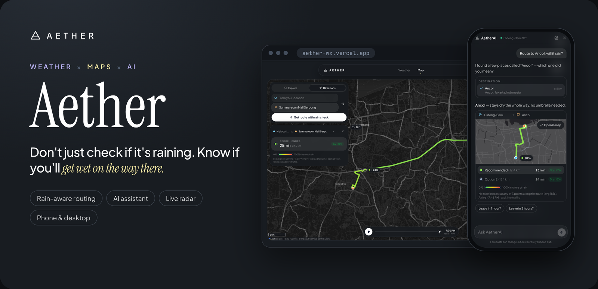
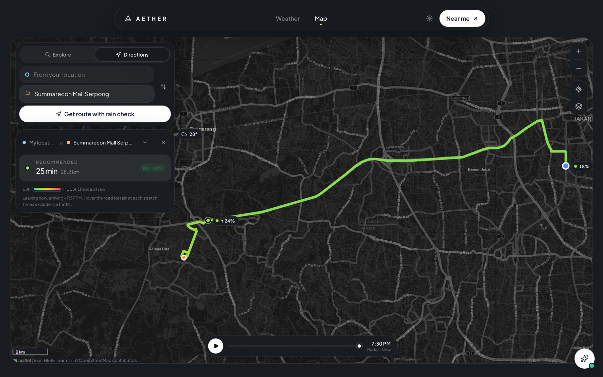
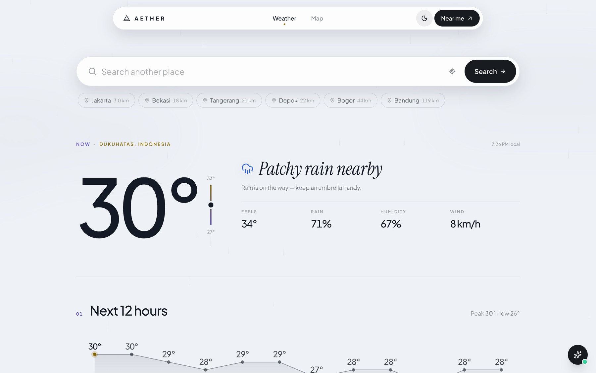
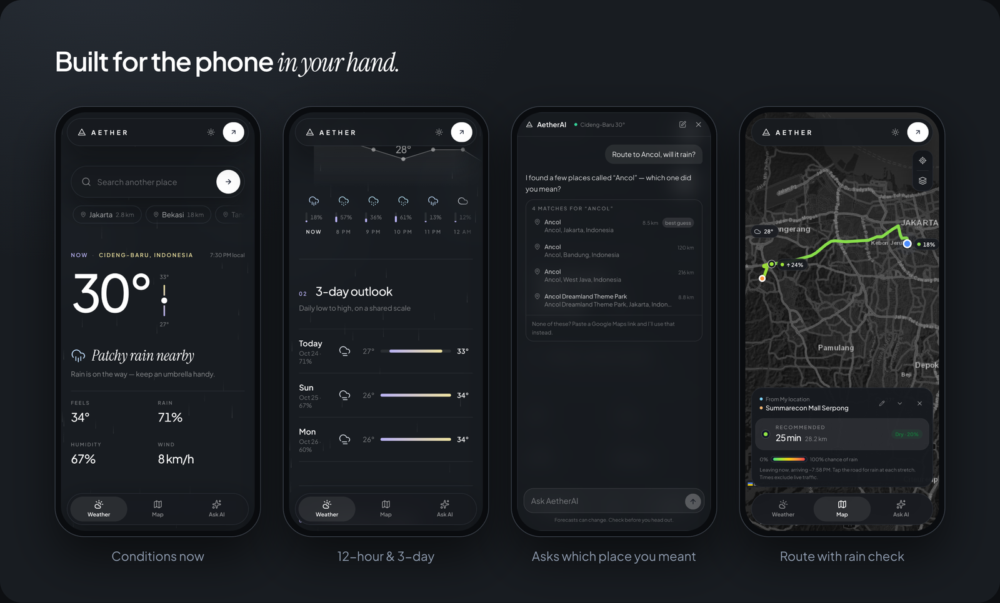
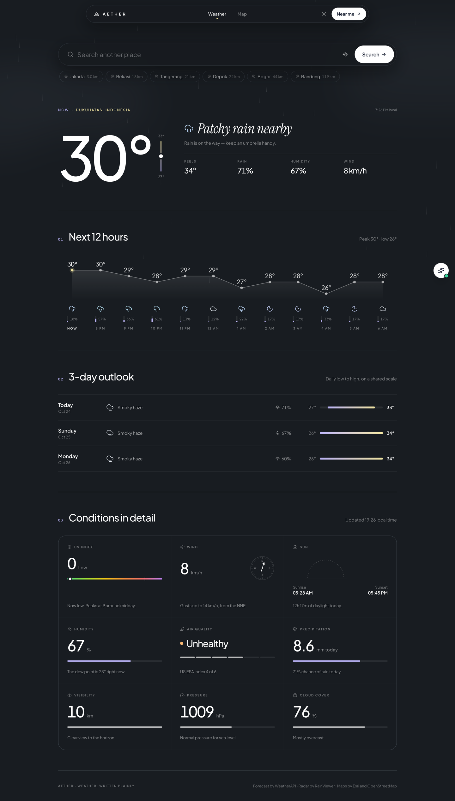
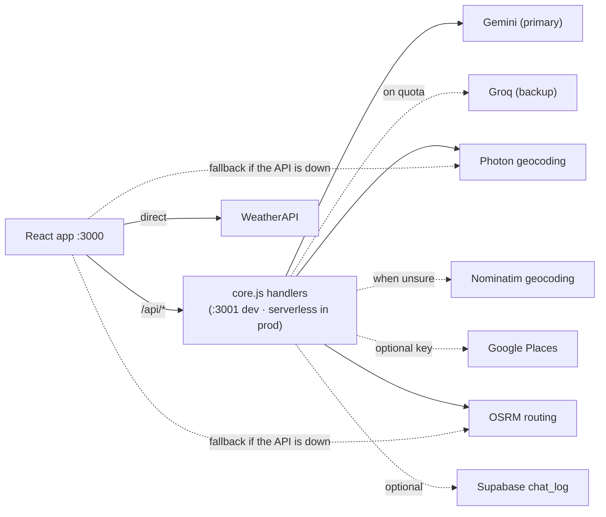

<p align="center">
  
</p>

<p align="center">
  <a href="https://aether-wx.vercel.app"><strong>Live demo → aether-wx.vercel.app</strong></a>
</p>

<p align="center">
  
  
  
  
  
  
  
</p>

<p align="center">
  Built by <a href="https://github.com/albertleooonardi"><strong>Albert Leonardi</strong></a>
</p>

---

## What is this?

Most weather apps answer *"is it raining?"*. Aether answers the question you actually had: **"will I get wet on the way there?"**

Ask the chat *"route to Ancol, will it rain?"* and it finds the place, pulls up to three driving routes from OSRM, and checks the forecast along each one **for the time you'd actually reach each stretch**. It then recommends the driest route and draws it on a map with a live radar overlay.

Around that sits a full weather dashboard: current conditions, a 12-hour and 3-day forecast, UV, air quality and wind. A small Node backend keeps the AI keys off the client. It all runs on free-tier APIs; the only key you really need is WeatherAPI's.

> Aether started life as *Vrijeme* (Bosnian/Croatian/Serbian for "weather"), which is why the package is still called `vrijeme`.

---

## 📸 A look around

<p align="center">
  
  <br><em>The dashboard: conditions now, with nearby cities one tap away.</em>
</p>

<table>
<tr>
<td width="50%">

<p align="center"><em>Directions with a rain check: each stretch is coloured by its chance of rain when you get there.</em></p>
</td>
<td width="50%">

<p align="center"><em>Ask for a route in chat and the reply comes with its own live mini-map.</em></p>
</td>
</tr>
<tr>
<td width="50%">

<p align="center"><em>Weather questions for anywhere, not just the city on screen.</em></p>
</td>
<td width="50%">

<p align="center"><em>Full light and dark themes.</em></p>
</td>
</tr>
</table>

<p align="center">
  
</p>

<details>
<summary><strong>Full-length dashboard</strong></summary>
<p align="center"></p>
</details>

---

## 🧭 How to use it

**Check a route for rain**
1. Open **Map → Directions**.
2. The start defaults to your location. Type a destination, or paste a Google Maps link (short `maps.app.goo.gl` links work too).
3. Tap **Get route with rain check**. You get up to three routes, the driest one is marked **Recommended**, and you can tap or hover any stretch of road to see its rain chance at your arrival time.

**Ask AetherAI**
1. Tap **Ask AI** (the sparkle button on desktop).
2. Ask in plain words: *"route to Ancol, will it rain?"*, *"is it raining in Bandung?"*, *"where's it raining around Java?"*.
3. If a name matches several places, it lists them with distances and asks which one you meant.
4. Follow up with *"leave in 1 hour?"* or *"at 6pm"* to move the departure time. Tap **Open in map** for the full view.

**Everything else**
- **Near me** (top right) loads the weather where you are. Recent places and nearby cities appear as one-tap chips under the search bar.
- **Map → Explore**: search any place, tap anywhere on the map for its local weather, and play the radar timeline.
- *"Remind me at 5pm to bring an umbrella"* sets a local reminder.
- The sun/moon button switches between light and dark mode. Your last city and the chat history are remembered.

---

## ✨ Features

| | |
|---|---|
| 🗺️ **Rain-aware routing** | Compares up to 3 driving routes, scores each for rain, recommends the driest |
| ⏱️ **Judged at arrival time** | Each stretch is checked against the forecast for the hour you'd actually reach it. Say "at 6pm" to plan ahead |
| 🌧️ **Rain painted on the road** | Each stretch is coloured by its chance of rain, green → red, with the % stated in words too |
| 🔀 **Switchable routes** | Tap any alternative to draw it instead and see its own rain breakdown |
| 🤖 **Tool-calling AI** | AetherAI can look up weather, scan many cities at once, and compute routes mid-answer, then draw the map itself |
| 🎯 **Google-grade place search** | Ranked results benchmarked against Google Maps' first pin. Optional Google Places key for exact parity |
| 📍 **Asks before it guesses** | When a name matches several places, it lists them with distances and lets you pick |
| 🔗 **Google Maps links** | Paste any Maps URL, including `maps.app.goo.gl` short links, as a destination |
| 📡 **Live radar map** | Leaflet map with a RainViewer precipitation overlay on Esri basemaps |
| ⏰ **Weather reminders** | "remind me at 5pm to bring an umbrella": saved and scheduled locally |
| 🌡️ **Rich conditions** | Feels-like, humidity, dew point, pressure, visibility, cloud cover, gusts, sunrise/sunset |
| ☀️ **UV & air quality** | Live UV index with the daily peak, plus the US EPA air quality index |
| 🎨 **Dynamic UI** | Backgrounds and animations change with the weather and time of day. Full light/dark theming |
| 📱 **Phone-first** | Bottom tab bar, map sheets and a full-screen chat on phones, including iPhone Safari location |

---

## 🏗️ How it fits together

### The request path

In development there are two processes: the React app (`:3000`) and a small Node service (`:3001`). `npm start` boots both, and CRA proxies `/api` → `:3001`.

The same handlers run in development and production. [`api/_lib/core.js`](api/_lib/core.js) holds all the backend logic. It's wrapped twice: as Vercel serverless functions in [`api/`](api/) for production, and as a plain `node:http` server in [`server/index.js`](server/index.js) for local development. There's no Express and no framework, just one copy of the logic.



**Why have a backend at all?** It keeps the AI keys off the client. It sends the geocoders the `User-Agent` their usage policies require. And it can retry upstream calls server-side without hitting browser rate limits.

**When something fails, the app degrades instead of breaking.** The backend is optional: if it's down, the frontend calls the geocoder and OSRM directly. If the AI has no keys or is rate-limited, the chat falls back to a local rule-based assistant that still answers from the loaded weather data.

### What happens when you send a message

<p align="center">
  
</p>

Every message goes through five deterministic parsers first: reminders, Maps URLs, navigation, weather-in-a-place and follow-ups, in that order. The first match wins. They're plain regex, so they're instant, free, and work with no AI keys at all. Anything none of them handles goes to the model. If both AI providers fail, the local assistant answers instead, so the chat never goes silent.

### The interesting bits

<details>
<summary><strong>How rain scoring picks a route</strong></summary>

Two things make this more than "is it raining right now".

**Rain isn't uniform over a route.** [`RouteService.js`](src/services/RouteService.js) splits each alternative into 3–8 contiguous chunks, roughly one per 10 km, and judges each one separately. The map draws exactly that: one colour per stretch of road, so a shower halfway along shows up as its own band. A route is rated by its worst stretch, because one downpour still means you need an umbrella.

**Rain isn't uniform over time either.** On a 40-minute drive you reach the far end 40 minutes from now, so checking its weather *now* answers the wrong question. Each chunk is checked against the **hourly forecast for the hour you'd actually reach it**:

- OSRM is asked for `annotations=duration`, its own per-node timings, so each stretch's ETA follows real road speeds rather than a constant-speed guess.
- That ETA selects an hour from WeatherAPI's hourly forecast, matched on `time_epoch` (a true UTC instant, so time zones don't matter).
- Say `route to X at 6pm` and the whole timeline shifts to a 6pm departure.

Each chunk's verdict weighs both the expected amount and the probability:

```
not falling, <30% chance, ≤0.2mm  → dry
≥0.5mm expected, or ≥60% chance   → wet
otherwise                         → light
```

To rank alternatives, the score is *averaged*, not summed: `score = mean precipitation (mm) + mean chance of rain`. A sum would always make longer routes look wetter, simply because they get more samples.

"Precipitation is falling" is decided by WeatherAPI's condition **code** (`≥ 1150`), never by matching the word "rain" in the label. Code 1063 is *"Patchy rain nearby"*, meaning rain **around** the point rather than at it, and it's the default daytime condition across much of the tropics. Counting it marked every route wet.

If a stretch's ETA is past the forecast horizon, or the lookup fails, that stretch reports `unknown` (drawn dashed and labelled "No data"). It never quietly becomes "dry".
</details>

<details>
<summary><strong>How the route colours work</strong></summary>

[`RouteLevels.js`](src/utils/RouteLevels.js) is the single source of truth for the colours, shared by the inline chat map and the full map page so they can't drift apart.

Each stretch is painted by its **chance of rain** on a continuous green → lime → yellow → orange → red ramp. A stretch classed as rain because of the *amount* expected is never painted greener than its level: light rain is painted at least 35%, rain at least 75%.

Red and green alone are hard to tell apart for about 8% of men, so the colour is never the only signal:
- The ramp also changes in lightness.
- Every tooltip and badge states the percentage in words.
- "No data" uses a warm neutral off the ramp and is drawn as a **dashed** line.

There's one stroke ramp per basemap (dark and light), tuned for contrast against measured land colours. Badge text uses a separate set of values that clears 3:1 on both the white and the dark panel. All of this is asserted in [`RouteLevels.test.js`](src/utils/RouteLevels.test.js), so a well-meaning colour tweak fails the suite instead of quietly becoming unreadable.
</details>

<details>
<summary><strong>How the AI failover and tool calling work</strong></summary>

[`api/_lib/core.js`](api/_lib/core.js) treats Gemini and Groq as interchangeable:
- On a quota or rate-limit error, the exhausted provider is sidelined for a cooldown and the request retries on the backup.
- Groq has its own list of overflow models, tried in turn.
- A hung model call times out and gets a short cooldown, so one slow provider can't stall the chat.

The backend also tracks daily token use per provider, enforces optional budgets, and trims history to a configurable window. Live stats are available at `/api/usage`.

The model has three tools and can make up to four tool-calling steps per turn:

| Tool | What it does |
|---|---|
| `get_weather(location)` | Live conditions, hourly and 3-day forecast for **any** place, not just the loaded city |
| `get_rain_overview(locations[])` | Rain status for up to 12 places in one call, for questions like "where's it raining around Java?" |
| `get_route(origin, destination)` | Driving distance, time, and the per-stretch rain breakdown |

When the model calls `get_route`, the frontend picks up the call and **renders the route as a real Leaflet map inside the reply**, using the same component as the map page. The prose and the map come from the same lookup.

Each request also tells the model what's on screen: the route card currently shown and any pending reminders. That way a follow-up like *"what about the other option?"* refers to what the user is actually looking at.
</details>

<details>
<summary><strong>How it finds the place you meant</strong></summary>

Place names are rarely unique, so [`GeoService.js`](src/services/GeoService.js) and [`placeRank.js`](src/utils/placeRank.js) return a *ranked list* rather than a single guess.

- **Ranking** scores how much of the query each result's name and area cover, with an exact-name bonus. It understands acronyms (*ICE BSD* → Indonesia Convention Exhibition), local abbreviations (*RS* means hospital), how important a place is, and how far away it is. Car parks, entrances and other parts of a place are pushed down, and implausibly distant results get a penalty.
- **Sources**: Photon answers first. If the leading result looks doubtful, Photon's local-language index and Nominatim (which knows alternative names) are asked as well. As-you-type suggestions stay on Photon only. With `GOOGLE_MAPS_API_KEY` set, search uses Google Places (New) instead.
- **Benchmarked against Google Maps**: on a set of 24 Jakarta-area queries checked against Google Maps' first pin, Aether's top result now matches **24/24** (up from 21). On 20 queries the ranking was never tuned on, it matches **18/20** (up from 16).
- **One match** → route straight there. **Several** → the chat asks, listing each with its distance. **None** → paste a Google Maps link. `maps.app.goo.gl` short links are followed server-side by `/api/resolve`, which only follows Google map hosts.
</details>

<details>
<summary><strong>How the chatbot's context retention was measured</strong></summary>

"The AI keeps losing track of the conversation" isn't a bug report you can act on, so a small eval harness (kept locally, not in this repo) turns it into a number.

There are ten multi-turn cases. Each plants a fact early and later asks a question that can only be answered by remembering it. Two cases deliberately plant the fact *beyond* the history window as a control. That separates **truncation** (the fact never reached the model) from **prompt defects** (it did, and the model still got it wrong).

Scoring uses an LLM judge from a different model family. Widening `AI_HISTORY_TURNS` from 6 to 16 moved the score from **16/20 to 18/20** with no regressions.
</details>

---

## 🚀 Getting started

### Prerequisites

- **Node.js 18+**
- A free [WeatherAPI.com](https://www.weatherapi.com/) key (required)
- Optional: a [Gemini](https://aistudio.google.com/app/apikey) and/or [Groq](https://console.groq.com/keys) key for AI chat

### 1. Clone and install

```bash
git clone https://github.com/albertleooonardi/aether.git
cd aether
npm install
```

### 2. Configure

```bash
cp .env.example .env.local
```

Open `.env.local` and add your keys. **Only `REACT_APP_WEATHER_API_KEY` is required.** Everything else is optional. If you leave the AI keys blank, the chat uses the local assistant.

> 🔒 `.env`, `.env.local` and every other `.env.*` file are gitignored (only `.env.example` is committed). Never commit real keys. Server-side keys such as `GEMINI_API_KEY` and `SUPABASE_SERVICE_KEY` must never go in a `REACT_APP_*` variable.

### 3. Run

```bash
npm start
```

One command starts the backend on `:3001` and the React app on `:3000`, and Ctrl-C stops both. Open **http://localhost:3000**.

<details>
<summary><strong>Running the two halves separately</strong></summary>

```bash
npm run server   # terminal 1 → Node service on :3001
npm run web      # terminal 2 → React app on :3000
```

The frontend also runs on its own. You lose AI chat, and geocoding and routing fall back to direct calls.
</details>

<details>
<summary><strong>Testing location on a phone (HTTPS)</strong></summary>

iPhone Safari only allows geolocation over HTTPS. `npm run start:https` serves the dev app over HTTPS so you can test **Near me** from a phone on the same network.
</details>

---

## ⚙️ Environment variables

**Frontend** (must be prefixed `REACT_APP_`; baked in at build time):

| Variable | Required | Description |
|---|---|---|
| `REACT_APP_WEATHER_API_KEY` | **Yes** | WeatherAPI.com key. The app can't load weather without it |

**Backend** (all optional):

| Variable | Default | Description |
|---|---|---|
| `WEATHER_API_KEY` | falls back to the `REACT_APP_` key | Server-side WeatherAPI key for the chat's tool lookups |
| `GOOGLE_MAPS_API_KEY` | — | Turns on Google Places (New) Text Search for place search. Restrict the key to that API |
| `GEMINI_API_KEY` | — | Enables Gemini. Leave blank to skip this provider |
| `GEMINI_MODEL` | `gemini-flash-latest` | Gemini model ID |
| `GEMINI_THINKING_BUDGET` | `0` | Gemini thinking tokens (`0` = off) |
| `GROQ_API_KEY` | — | Enables Groq. Leave blank to skip this provider |
| `GROQ_MODEL` | `llama-3.3-70b-versatile` | Groq model ID |
| `GROQ_FALLBACK_MODELS` | see `.env.example` | Overflow Groq models, tried when the first is rate-limited |
| `AI_PRIMARY` | `gemini` | Which provider is tried first (`gemini` or `groq`) |
| `AI_MAX_OUTPUT_TOKENS` | `450` | Maximum reply length |
| `AI_HISTORY_TURNS` | `6` | Number of recent **messages** sent as context. The eval measured 16 as better |
| `AI_COOLDOWN_MS` | `1800000` | How long a provider with a spent quota is sidelined |
| `AI_SHORT_COOLDOWN_MS` | `120000` | How long a hung or overloaded model is sidelined |
| `AI_PROVIDER_TIMEOUT_MS` | `10000` | Timeout for each model call |
| `GEMINI_TOKEN_BUDGET` / `GROQ_TOKEN_BUDGET` | `0` | Daily token caps (`0` = unlimited) |
| `SUPABASE_URL` | — | Enables chat-turn logging. Leave blank and `/api/log` does nothing |
| `SUPABASE_SERVICE_KEY` | — | Supabase `service_role` key. **Server-side only**: it bypasses row-level security (RLS) |
| `PORT` | `3001` | Backend port |

---

## 📜 Scripts

| Command | Does |
|---|---|
| `npm start` | Backend + React app together |
| `npm run start:https` | Same, served over HTTPS (for phone geolocation) |
| `npm run web` | React dev server alone on `:3000` |
| `npm run server` | Node backend alone on `:3001` |
| `npm run build` | Production bundle into `build/` |
| `npm test` | Jest in watch mode (`CI=true npm test` to run once) |

---

## 🧪 Tests

**357 tests**, covering:
- intent parsing and the deterministic assistant
- chat routing in the widget
- the `/api/chat` handler and its tool loop
- geocoding fallbacks and place ranking
- route scoring
- the contrast invariants of the rain colours

```bash
CI=true npm test
```

> CRA limits Jest to `src/`, so tests for backend code live under `src/` (e.g. [`src/chat/chatHandler.test.js`](src/chat/chatHandler.test.js)) even though the code they test lives in `api/`.

---

## 🔌 API reference

| Endpoint | Returns |
|---|---|
| `GET /api/health` | Service status and which AI providers have keys |
| `GET /api/usage` | Token usage, budgets and cooldowns for each provider |
| `GET /api/geocode?q=…&near=lat,lon` | Ranked list of candidate places. `near` biases results toward the user |
| `GET /api/resolve?url=…` | Coordinates from a Google Maps link, following short links (Google map hosts only) |
| `GET /api/route?from=lat,lon&to=lat,lon` | OSRM driving routes with alternatives |
| `POST /api/chat` | `{ messages, context }` → AI reply, tool-call actions and provider metadata |
| `POST /api/log` | Fire-and-forget chat logging to Supabase. Does nothing without `SUPABASE_URL` |

---

## 📁 Project structure

```
api/
├── _lib/core.js            # Every backend handler (the one copy of the logic)
└── *.js                    # Vercel serverless wrappers (chat, geocode, route, …)

server/index.js             # The same handlers behind node:http, for local dev
scripts/dev.js              # One-command launcher for both processes

src/
├── App.js                  # State, data flow, layout
├── chat/                   # Deterministic intents + local fallback assistant
├── components/
│   ├── chat/               # Chat widget, inline route map, place picker
│   ├── map/                # Full map page: Explore + Directions
│   ├── search/             # Shared typeahead menu
│   └── …                   # Weather cards, forecasts, UV, wind, animations
├── services/               # AetherAI, Geo, Route, Weather, Storage clients
└── utils/
    ├── placeRank.js        # Place ranking, shared by server and client
    ├── RouteLevels.js      # Rain colours and what they claim
    └── …                   # Icons, theming, time helpers

supabase/migrations/        # Optional chat_log table
docs/images/                # Screenshots used by this README
```

---

## ⚠️ Known limitations

- **No live traffic.** OSRM's public server routes on free-flow speeds, so its durations are optimistic in a congested city. Because rain is judged at your ETA, a wrong ETA checks the forecast for the wrong hour. A traffic-aware provider (Mapbox, TomTom, Google) would drop straight in.
- **OSRM public demo server**: free, but rate-limited and with no uptime guarantee. Self-host it for anything serious.
- **POI coverage is only as good as OpenStreetMap** unless you add a Google Places key. A place missing from OSM can't be found by Photon or Nominatim.
- **Radar tops out at zoom 7.** RainViewer's free tiles stop there, so at city scale the overlay is coarse. That's the real resolution of the data.
- **Rain sampling is a heuristic**: a handful of points per route against an hourly forecast. It's good for "should I take an umbrella", not for meteorology.
- **`REACT_APP_*` keys are public.** They're embedded in the bundle, so restrict the WeatherAPI key at the provider.
- **Free AI tiers run out.** That's what the failover and the local assistant are for, but expect replies to change in style when they kick in.

---

## 👤 Author

**Albert Leonardi** · [github.com/albertleooonardi](https://github.com/albertleooonardi)

Issues and pull requests are welcome at [albertleooonardi/aether](https://github.com/albertleooonardi/aether).

## 📄 License

MIT.

## 🙏 Acknowledgements

[WeatherAPI](https://www.weatherapi.com/) · [Photon](https://photon.komoot.io/) · [OpenStreetMap Nominatim](https://nominatim.org/) · [OSRM](https://project-osrm.org/) · [RainViewer](https://www.rainviewer.com/) · [Esri](https://www.arcgis.com/) · [Leaflet](https://leafletjs.com/) · [Lucide](https://lucide.dev/)
