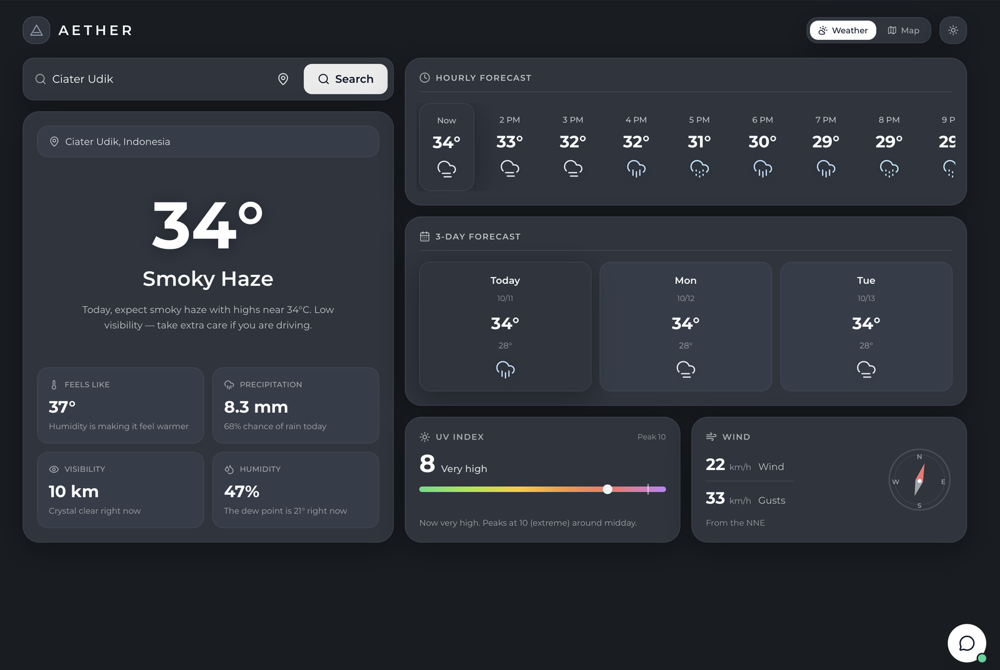
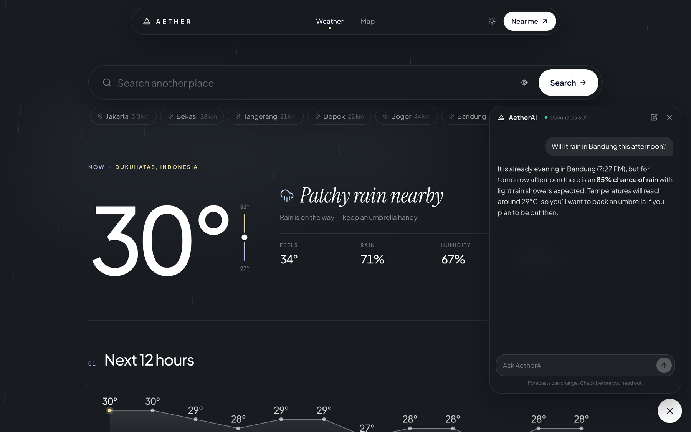
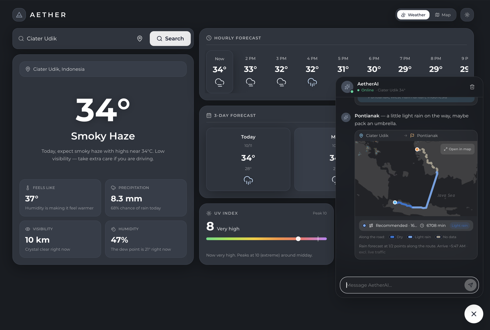
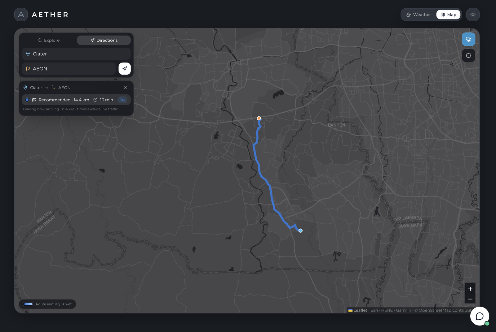
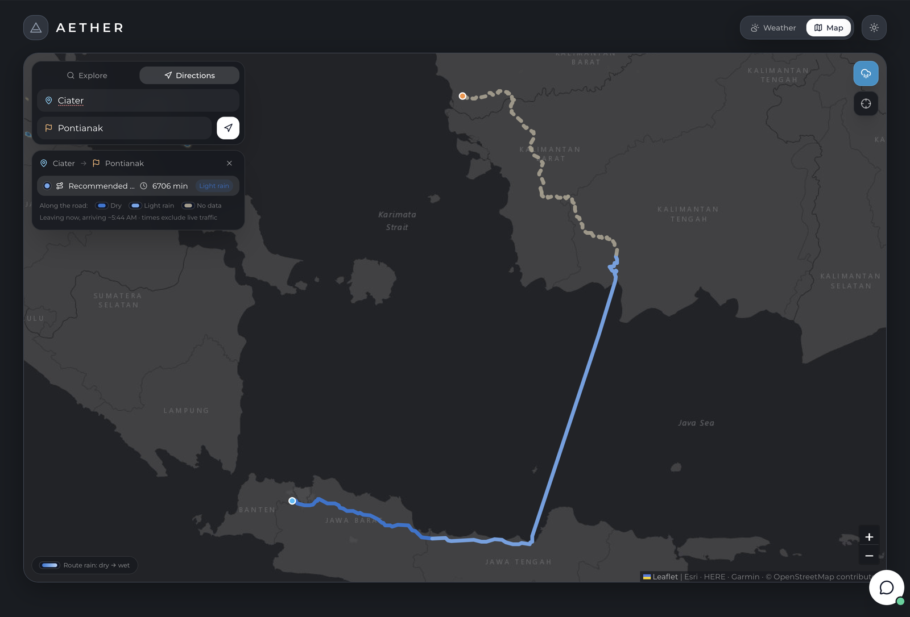
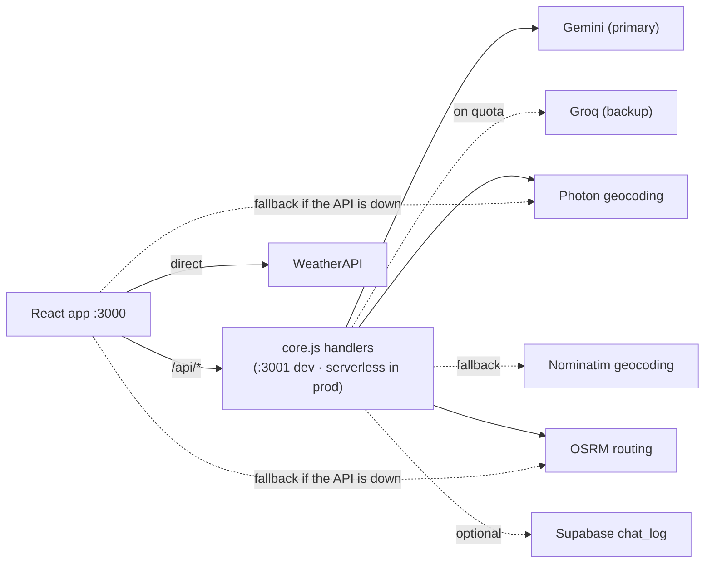
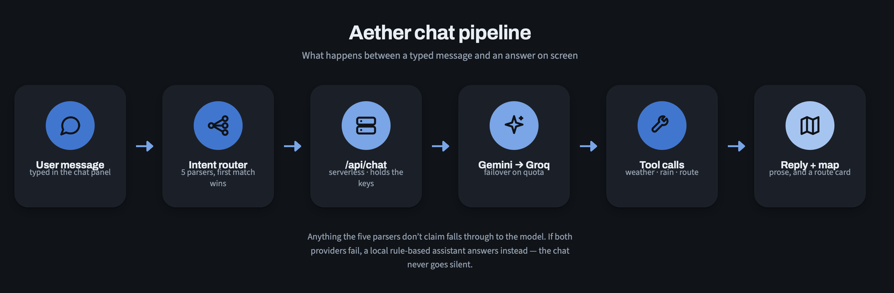

<p align="center">
  
</p>

<p align="center">
  <strong>A weather app that doesn't just tell you it's raining — it tells you which way to drive to avoid it.</strong>
</p>

<p align="center">
  
  
  
  
  
  
</p>

<p align="center">
  Built by <a href="https://github.com/albertleooonardi"><strong>Albert Leonardi</strong></a> ·
  <a href="https://github.com/albertleooonardi/aether">github.com/albertleooonardi/aether</a>
</p>

<p align="center">
  
</p>

---

## What is this?

**Aether** started life as *Vrijeme* (Bosnian/Croatian/Serbian for "weather" — hence the package name) and grew into something bigger: a weather dashboard with an AI assistant built into it, backed by a small Node service.

Most weather apps answer *"is it raining?"*. Aether answers the question you actually had: **"will I get wet on the way there?"** Ask the chat *"best route from my place to Grand Indonesia, will it rain?"* and it geocodes both ends, pulls up to three driving alternatives from OSRM, samples the forecast along each one **at the time you'd actually reach each stretch**, and recommends the driest — drawn live on a map with a radar overlay.

Everything runs on free, no-credit-card APIs. The only key you genuinely need is WeatherAPI's.

---

## 📸 A look around

<table>
<tr>
<td width="50%">

<p align="center"><em>AetherAI answers in prose <strong>and</strong> a structured card — conditions for anywhere, not just the loaded city.</em></p>
</td>
<td width="50%">

<p align="center"><em>Ask for a route and the reply carries its own mini-map, coloured stretch by stretch.</em></p>
</td>
</tr>
<tr>
<td width="50%">

<p align="center"><em>The full map page: typeahead search, alternatives, and the arrival-time caveat stated up front.</em></p>
</td>
<td width="50%">

<p align="center"><em>Past the forecast horizon a stretch reports <strong>No data</strong> — dashed, never quietly "dry".</em></p>
</td>
</tr>
</table>

---

## ✨ Features

| | |
|---|---|
| 🗺️ **Rain-aware routing** | Compares up to 3 driving routes, scores each for rain, recommends the driest |
| ⏱️ **Judged at arrival time** | Each stretch is checked against the forecast for the hour you'd actually reach it — say "at 6pm" to plan ahead |
| 🌧️ **Rain painted on the road** | The route is drawn stretch by stretch on a single-hue blue ramp: dry → light rain → rain |
| 🔀 **Switchable routes** | Tap any alternative to draw it instead and see its own rain breakdown |
| 🤖 **Tool-calling AI** | AetherAI can look up weather, scan many cities at once, and compute routes mid-answer — then render the map itself |
| ⌨️ **Typeahead search** | Explore and Directions both suggest places as you type, debounced and abortable |
| 📍 **Asks before it guesses** | When a name matches several places, it lists them with distances and lets you pick |
| 🔗 **Google Maps links** | Paste any Maps URL — including `maps.app.goo.gl` short links — as a destination |
| 📡 **Live radar map** | Leaflet map with RainViewer precipitation overlay on Esri's Gray Canvas basemap |
| ⏰ **Weather reminders** | "remind me at 5pm to bring an umbrella" — persisted and scheduled locally |
| 🌡️ **Rich conditions** | Feels-like, humidity, dew point, pressure, visibility, cloud cover, gusts |
| 📅 **Forecasts** | Next 12 hours + 3-day outlook |
| ☀️ **UV & air quality** | Live UV index with daily max, plus US EPA air quality index |
| 🎨 **Dynamic UI** | Backgrounds, icons and animations shift with conditions and time of day; full light/dark theming |
| 💾 **Remembers you** | Last city and the whole chat transcript restored from `localStorage` |
| 📱 **Responsive** | Mobile through desktop |

---

## 🏗️ How it fits together

### The request path

Two processes in development: the React app (`:3000`) and a small Node service (`:3001`). `npm start` boots both. CRA proxies `/api` → `:3001` via the `proxy` field in `package.json`.

The same handlers run in both places. [`api/_lib/core.js`](api/_lib/core.js) holds every bit of backend logic; it's wrapped twice — once as Vercel serverless functions in [`api/`](api/) for production, once as a plain `node:http` server in [`server/index.js`](server/index.js) for local development. No Express, no framework, one copy of the logic.



**Why a backend at all?** Three reasons: it keeps AI keys off the client, it sends the geocoders the polite `User-Agent` their usage policies require, and it can retry upstream calls server-side without tripping browser rate limits.

**Everything degrades instead of breaking.** The backend is optional — if it's down, the frontend calls the geocoder and OSRM directly. If the AI has no keys or is rate-limited, chat falls back to a local deterministic assistant that still answers from loaded weather data. Geocoding tries four tiers (proxy → Photon → Nominatim → WeatherAPI search) before giving up.

### What happens when you send a message

<p align="center">
  
</p>

Five deterministic parsers get first refusal on every message — reminders, Maps URLs, navigation, weather-in-a-place, follow-ups — in that order, first match wins. They're plain regex, so they're instant, free, and work with no AI keys at all. Only what none of them claims falls through to the model. If both providers fail, the local rule-based assistant answers instead; the chat never goes silent.

### The interesting bits

<details>
<summary><strong>How rain scoring picks a route</strong></summary>

Two things make this more than "is it raining right now".

**Rain isn't uniform over a route.** [`RouteService.js`](src/services/RouteService.js) cuts each alternative into contiguous chunks (3–8, roughly one per 10 km) and judges each one separately. That's what the map draws: **one colour per stretch of road**, so a shower halfway along shows up as a darker band with dry road either side. A route reads as bad as its worst stretch — one downpour still means taking an umbrella.

**Rain isn't uniform over time either.** The far end of a 40-minute drive is 40 minutes away, so asking about it *now* answers the wrong question. Each chunk is checked against the **hourly forecast at the hour you'd actually reach it**:

- OSRM is asked for `annotations=duration` — its own per-node timings — so the ETA for each stretch follows real road speeds. On a Jakarta→BSD run the three chunks land at +4, +12 and +26 minutes, not the evenly-spaced +5/+16/+27 a constant-speed guess would produce.
- That instant picks an hour out of WeatherAPI's hourly forecast (matched on `time_epoch`, a true UTC instant, so timezones don't enter into it).
- Say `route to X at 6pm` and the whole timeline shifts to a 6pm departure.

Each chunk's verdict weighs amount *and* probability, because they answer different questions — "40% chance, 0mm" means it might rain and probably won't amount to much:

```
not falling, <30% chance, ≤0.2mm  → dry
≥0.5mm expected, or ≥60% chance   → wet
otherwise                         → light
```

To rank alternatives, the score is *averaged*, not summed:

```
score = mean precipitation (mm) + mean chance of rain
```

Summing would punish long routes: they get more samples, so they'd always look wetter than a short route in identical weather. Chunk counts are capped at 8 because each chunk is one WeatherAPI call, times every alternative.

If a stretch's ETA lands past the forecast horizon, or the lookups fail, that stretch reports `unknown` — it never quietly becomes "dry".

"Precipitation is falling" is decided by WeatherAPI's condition **code** (`≥ 1150`), never by matching the word "rain" in the label. Code 1063 is *"Patchy rain nearby"* — rain **around** the point, not on it — and it's the default daytime condition across much of the tropics. Counting it marked every route wet. Matching text also misses drizzle and sleet, whose labels never say "rain".

If every sample fails, the route reports `unknown` rather than scoring 0 and promising a dry trip nobody checked.
</details>

<details>
<summary><strong>Why the route colours are all blue</strong></summary>

[`RouteLevels.js`](src/utils/RouteLevels.js) is the single source of truth for what the colours claim, shared by the inline chat map and the full map page so the two can never drift apart.

`dry → light → wet` is an **ordered** sequence, so it gets a single-hue ramp whose lightness carries the order. The original green/amber/red spent three unrelated hues on ordered data and put the main signal — dry versus rain — squarely on the red-green axis that roughly 8% of men cannot separate. Blue is also the honest hue for water.

There are **two stroke ramps**, because routes are drawn on both of Esri's basemaps:

- On **Dark Gray** the ramp runs dark → light as rain increases, so wet stretches glow and dry road recedes.
- On **Light Gray** it runs the opposite way, light → dark, for exactly the same reason — on a pale surface the darker step is the salient one.

Panel text uses a third set of values (`ink`), tuned for 3:1 against both the white and the dark panel rather than against map tiles. Those steps are deliberately disjoint from every stroke step: when the ramps crossed, a badge reading "Light rain" came out the same hex the legend beside it labelled "Dry".

All of it is asserted in [`RouteLevels.test.js`](src/utils/RouteLevels.test.js) — contrast against measured basemap colours, monotone lightness, minimum ΔL between steps — so a well-meaning tweak fails the suite instead of quietly going invisible. "No data" also breaks the line into dashes, so absence is never signalled by colour alone.
</details>

<details>
<summary><strong>How the AI failover and tool calling work</strong></summary>

[`api/_lib/core.js`](api/_lib/core.js) treats Gemini and Groq as interchangeable. On a quota or rate-limit error (`429`, `402`, or a matching message) the exhausted provider is sidelined for a cooldown (default 30 min) and the request retries on the backup. It tracks per-provider daily token usage, enforces optional budgets, trims history to a configurable window, and caps replies. Live stats are exposed at `/api/usage` and surfaced in the chat's usage panel.

The model isn't answering from the prompt alone. It has three tools, and up to four tool-calling steps per turn:

| Tool | What it does |
|---|---|
| `get_weather(location)` | Live conditions, hourly and 3-day forecast for **any** place, not just the loaded city |
| `get_rain_overview(locations[])` | Rain status for up to 12 places in one call — for "where's it raining around Java?" |
| `get_route(origin, destination)` | Driving distance, time, and the per-stretch rain breakdown |

When the model calls `get_route`, the frontend doesn't just print the numbers — it catches the call and **renders the route as a real Leaflet map inside the reply**, the same component the map page uses. The prose and the picture come from one lookup.

The model is also told what's on screen. Every request carries a `displayed` block — the route card currently above the conversation, the user's pending reminders — so follow-ups like *"what about the other option?"* resolve against what the user is actually looking at, and the model is instructed not to restate figures already visible.
</details>

<details>
<summary><strong>How chat understands you without calling the AI</strong></summary>

Intent parsing is deterministic and runs *before* any AI call. [`intents.js`](src/chat/intents.js) and [`assistant.js`](src/chat/assistant.js) use plain regex to recognise routing, weather-in-a-place, follow-ups and reminders. Only genuinely open-ended messages reach the LLM. It's cheaper, instant, and works offline.

It's also fussier than it looks. The navigation parser handles inflections (`travel`/`travelling`/`commute`), guards against time words being swallowed as place names (`route to Bogor at 6pm` must not geocode "Bogor at 6pm"), masks abbreviation dots so `Jl. Sudirman` isn't cut in half at the full stop, and scans for the *last* preposition first so `from A to B` doesn't lose its destination. Each of those is a regression test.
</details>

<details>
<summary><strong>How it decides where you meant</strong></summary>

A place name is rarely unique. "Grand Indonesia" matches the mall, its sky bridge, and an estate agent's office 27 km away — so [`GeoService.js`](src/services/GeoService.js) returns a *ranked list* rather than a single guess.

- **One match** → route straight there.
- **Several** → the chat asks, listing each with its distance from your origin. Candidates within 150 m of each other are collapsed, since a mall and its own footbridge aren't a real choice.
- **None, or none of them right** → paste a Google Maps link. Full URLs are parsed client-side; `maps.app.goo.gl` short links carry no coordinates, so `/api/resolve` follows the redirect server-side (the browser can't read a cross-origin one). Only Google map hosts are followed.

Each source gets its own 5-second budget under a 12-second overall deadline, so one slow-but-healthy tier can't starve the ones behind it.
</details>

<details>
<summary><strong>How the chatbot's context retention was measured</strong></summary>

"The AI keeps losing track of the conversation" isn't a bug report you can act on, so [`evals/`](evals/) turns it into a number.

Ten multi-turn cases, each with a fact planted early and a question that can only be answered by remembering it. Every case records a `distance` — how many messages back the needed fact sits — and two cases are deliberately planted *beyond* the history window as a control group. That separates **truncation** (the fact never reached the model) from **prompt defects** (it did, and the model still fumbled it), which otherwise look identical from the outside.

Scoring is LLM-as-judge on a 0/1/2 rubric, deliberately run on a different model family from the subject. The runner is two-phase and resumable: generation writes one case at a time, so a rate limit twelve cases in doesn't throw away the eleven that worked, and re-grading is free.

Result: widening `AI_HISTORY_TURNS` from 6 to 16 moved the score from **16/20 to 18/20** with no regressions. It also surfaced a prompt bug nobody would have found by reading the prompt — the model broke on *"Is it hotter there than here?"* because the system prompt never defined what "here" meant.

```bash
node evals/run.js --label baseline                 # generate, then grade
node evals/run.js --label wide --history 16        # try a wider window
node evals/run.js --label baseline --phase grade   # re-grade saved replies only
```
</details>

---

## 🚀 Getting started

### Prerequisites

- **Node.js 18+** (developed on v24)
- A free [WeatherAPI.com](https://www.weatherapi.com/) key — required
- Optionally, a [Gemini](https://aistudio.google.com/app/apikey) and/or [Groq](https://console.groq.com/keys) key for AI chat

### 1. Clone and install

```bash
git clone https://github.com/albertleooonardi/aether.git
cd aether
npm install
```

### 2. Configure

```bash
cp .env.example .env.local
```

Then open `.env.local` and add your keys. **Only `REACT_APP_WEATHER_API_KEY` is required** — without it, no weather loads. Everything else is optional; leave the AI keys blank and chat quietly uses the local assistant.

> `.env.local` and `.env` are both gitignored. Keep them that way — never commit real keys.

### 3. Run

```bash
npm start
```

That's it — one command boots the backend on `:3001` and the React app on `:3000`, with prefixed logs, and tears both down together on Ctrl-C.

Open **http://localhost:3000**.

<details>
<summary><strong>Running the two halves separately</strong></summary>

```bash
npm run server   # terminal 1 → Node service on :3001
npm run web      # terminal 2 → React app on :3000
```

Running the frontend alone works too — you lose AI chat, and geocoding/routing fall back to direct calls.
</details>

<details>
<summary><strong>Port 3001 already in use?</strong></summary>

```bash
lsof -ti :3001 | xargs kill    # free it
PORT=3002 npm run server       # or run elsewhere
```
Note that CRA's `proxy` in `package.json` points at `3001`; update it if you move the port.
</details>

---

## ⚙️ Environment variables

**Frontend** (must be prefixed `REACT_APP_`, baked in at build time):

| Variable | Required | Description |
|---|---|---|
| `REACT_APP_WEATHER_API_KEY` | **Yes** | WeatherAPI.com key — the app can't load weather without it |

**Backend** (all optional):

| Variable | Default | Description |
|---|---|---|
| `WEATHER_API_KEY` | falls back to the `REACT_APP_` one | Server-side WeatherAPI key for the chat's own tool lookups. Lets you keep an unrestricted key on the server and expose only a restricted one in the bundle |
| `GEMINI_API_KEY` | — | Enables Gemini. Blank = provider skipped |
| `GEMINI_MODEL` | `gemini-flash-lite-latest` | Gemini model id. The non-lite `gemini-flash-latest` exhausts the free daily quota fast, and an exhausted tier may hang rather than answer 429 |
| `GEMINI_THINKING_BUDGET` | `0` | Gemini thinking tokens (`0` = off) |
| `GROQ_API_KEY` | — | Enables Groq. Blank = provider skipped |
| `GROQ_MODEL` | `llama-3.3-70b-versatile` | Groq model id |
| `AI_PRIMARY` | `gemini` | Which provider leads (`gemini` or `groq`) |
| `AI_MAX_OUTPUT_TOKENS` | `450` | Reply length cap |
| `AI_HISTORY_TURNS` | `6` | Trailing **messages** sent as context (6 = 3 exchanges). The eval harness measured 16 as meaningfully better |
| `AI_COOLDOWN_MS` | `1800000` | How long a rate-limited provider is sidelined |
| `GEMINI_TOKEN_BUDGET` | `0` | Daily token cap (`0` = unlimited) |
| `GROQ_TOKEN_BUDGET` | `0` | Daily token cap (`0` = unlimited) |
| `SUPABASE_URL` | — | Enables chat-turn logging. Blank = `/api/log` no-ops |
| `SUPABASE_SERVICE_KEY` | — | Supabase `service_role` key. **Server-side only** — it bypasses RLS and must never go in a `REACT_APP_*` var |
| `PORT` | `3001` | Backend port |

---

## 📜 Scripts

| Command | Does |
|---|---|
| `npm start` | Backend + React app together, one command |
| `npm run web` | React dev server alone on `:3000` |
| `npm run server` | Node backend alone on `:3001` |
| `npm run build` | Production bundle into `build/` |
| `npm test` | Jest in watch mode (`CI=true npm test` to run once) |

---

## 🧪 Tests

**233 tests across 11 suites**, covering intent parsing, the deterministic assistant, chat routing in the widget, the `/api/chat` handler and its tool loop, geocoding fallbacks, route scoring, and the colour-contrast invariants of the rain ramp.

```bash
CI=true npm test
```

> One quirk worth knowing: CRA pins Jest's `roots` to `<rootDir>/src`, so tests for backend code live under `src/` (e.g. [`src/chat/chatHandler.test.js`](src/chat/chatHandler.test.js)) even though the code they exercise lives in `api/`.

---

## 🔌 API reference

| Endpoint | Returns |
|---|---|
| `GET /api/health` | Service status and which AI providers hold keys |
| `GET /api/usage` | Per-provider token usage, budgets, cooldowns |
| `GET /api/geocode?q=…&near=lat,lon` | Ranked candidate list for a place. `near` biases results toward the user |
| `GET /api/resolve?url=…` | Coordinates from a Google Maps link, following short links. Google map hosts only |
| `GET /api/route?from=lat,lon&to=lat,lon` | OSRM driving routes with alternatives |
| `POST /api/chat` | `{ messages, context }` → AI reply, tool-call actions, and provider metadata |
| `POST /api/log` | Fire-and-forget chat telemetry into Supabase. No-ops without `SUPABASE_URL` |

---

## 📁 Project structure

```
api/
├── _lib/core.js            # Every backend handler — the one copy of the logic
└── *.js                    # Vercel serverless wrappers (chat, geocode, route, …)

server/
└── index.js                # The same handlers behind node:http, for local dev

scripts/
└── dev.js                  # One-command launcher for both processes

src/
├── App.js                  # State, data flow, layout
├── chat/
│   ├── assistant.js        # Local fallback assistant + reminder parsing
│   └── intents.js          # Deterministic intent recognition
├── components/
│   ├── chat/               # Chat widget, inline route map, place picker, rich text
│   ├── map/                # Full map page with Explore + Directions
│   └── …                   # Weather cards, forecasts, UV, wind, animations
├── services/
│   ├── AetherAI.js         # Backend chat client
│   ├── GeoService.js       # Geocoding + typeahead (Photon → Nominatim → WeatherAPI)
│   ├── RouteService.js     # Routing + per-stretch rain assessment
│   ├── WeatherService.js   # WeatherAPI client
│   └── StorageService.js   # localStorage persistence
└── utils/
    ├── RouteLevels.js      # The rain colour ramps and what they claim
    └── …                   # Icons, theming, smooth zoom, time helpers

evals/                      # Context-retention eval harness + saved results
supabase/migrations/        # Optional chat_log table
docs/images/                # Screenshots used by this README
```

---

## ⚠️ Known limitations

- **No live traffic.** This is the big one. OSRM's public server routes on free-flow OSM speeds, so its durations are optimistic in a congested city — and since rain is judged at your ETA, a wrong ETA asks the forecast the wrong question. A 30-minute estimate that's really 50 in Jakarta traffic checks the wrong hour at the far end. A traffic-aware provider (Mapbox `driving-traffic`, TomTom, Google Directions — all need a key) would drop straight in: it only has to return durations, and everything downstream is unchanged.
- **OSRM public demo server** — free and unmetered, but rate-limited and offers no uptime guarantee. Self-host OSRM for anything serious.
- **POI coverage is only as good as OSM.** Photon handles named landmarks well and searches are biased toward your location, but a place missing from OpenStreetMap can't be found by either geocoder. Adding the city name helps.
- **Radar tops out at zoom 7.** RainViewer's free tiles don't exist above z7, so on a city-scale route the overlay is an upscaled — and visibly coarse — approximation. That's the real resolution of the data, not a rendering bug.
- **Basemap detail stops at zoom 16 in places.** Esri's Gray Canvas advertises deeper levels but serves "Map data not yet available" past z16 over Indonesia, so Leaflet is told to upscale rather than tile the screen with placeholders.
- **Rain sampling is still a heuristic** — a handful of points per route against an hourly forecast. Forecasts are wrong sometimes, an hour is a coarse bucket for a fast-moving tropical squall, and a chunk speaks for the road either side of it. Good for "should I take an umbrella", not for meteorology.
- **API keys are build-time.** `REACT_APP_*` values are embedded in the bundle, so a deployed frontend's WeatherAPI key is public. Restrict it at the provider, or proxy it through the backend.
- **Free AI tiers run out.** Gemini's daily quota is easy to exhaust in a day of testing. That's what the failover and the local assistant are for, but expect replies to change character when they kick in.

---

## 👤 Author

**Albert Leonardi** — [github.com/albertleooonardi](https://github.com/albertleooonardi)

Issues and pull requests are welcome at [albertleooonardi/aether](https://github.com/albertleooonardi/aether).

## 📄 License

MIT.

## 🙏 Acknowledgements

[WeatherAPI](https://www.weatherapi.com/) · [Photon](https://photon.komoot.io/) · [OpenStreetMap Nominatim](https://nominatim.org/) · [OSRM](https://project-osrm.org/) · [RainViewer](https://www.rainviewer.com/) · [Esri Gray Canvas](https://www.arcgis.com/home/item.html?id=291da5eab3a0412593b66d384379f89f) · [Leaflet](https://leafletjs.com/) · [Lucide](https://lucide.dev/)
